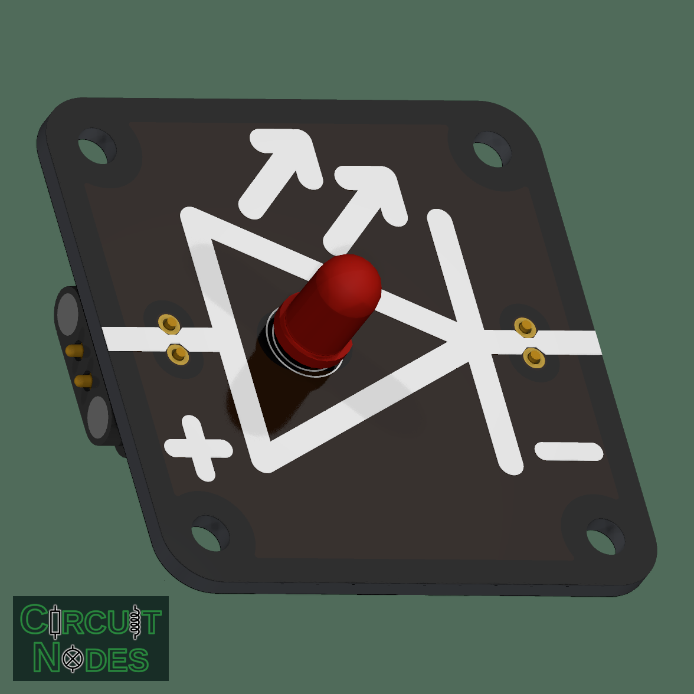
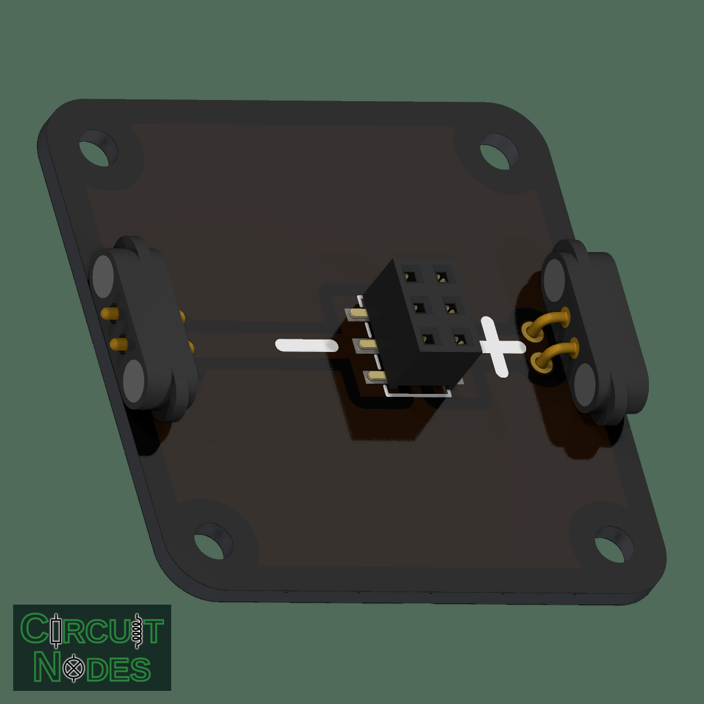

# Replaceable LED

This node holds a plug-in LED that can be replaced without soldering. Students can compare LED colors, observe one-way conduction, and investigate the relationship between current and brightness.

 

## Classroom experiments

- Compare the forward voltage of LEDs of different colors at the same current.
- Change the external series resistor to observe how current affects brightness.
- Reverse the connection to demonstrate polarity dependence, keeping reverse voltage within the LED's rating.

## Connection and replacement

Insert the LED according to the printed polarity markings. The flat side of a conventional round LED usually identifies the cathode; check the selected LED's datasheet, especially after its leads have been shortened. Disconnect the supply before replacing it, and support the socket while inserting or removing leads.

**Use an external series resistor or a suitable current-limited source. This node has no built-in current limiting or reverse-voltage protection.** Its replaceable LED can be damaged by excessive current or reverse voltage.

Choose the resistor using:

`R = (V_supply − V_forward) / I_LED`

Forward voltage depends on LED color, current, and temperature. Choose the current and resistor power rating for the fitted LED; do not connect it directly across a supply.
