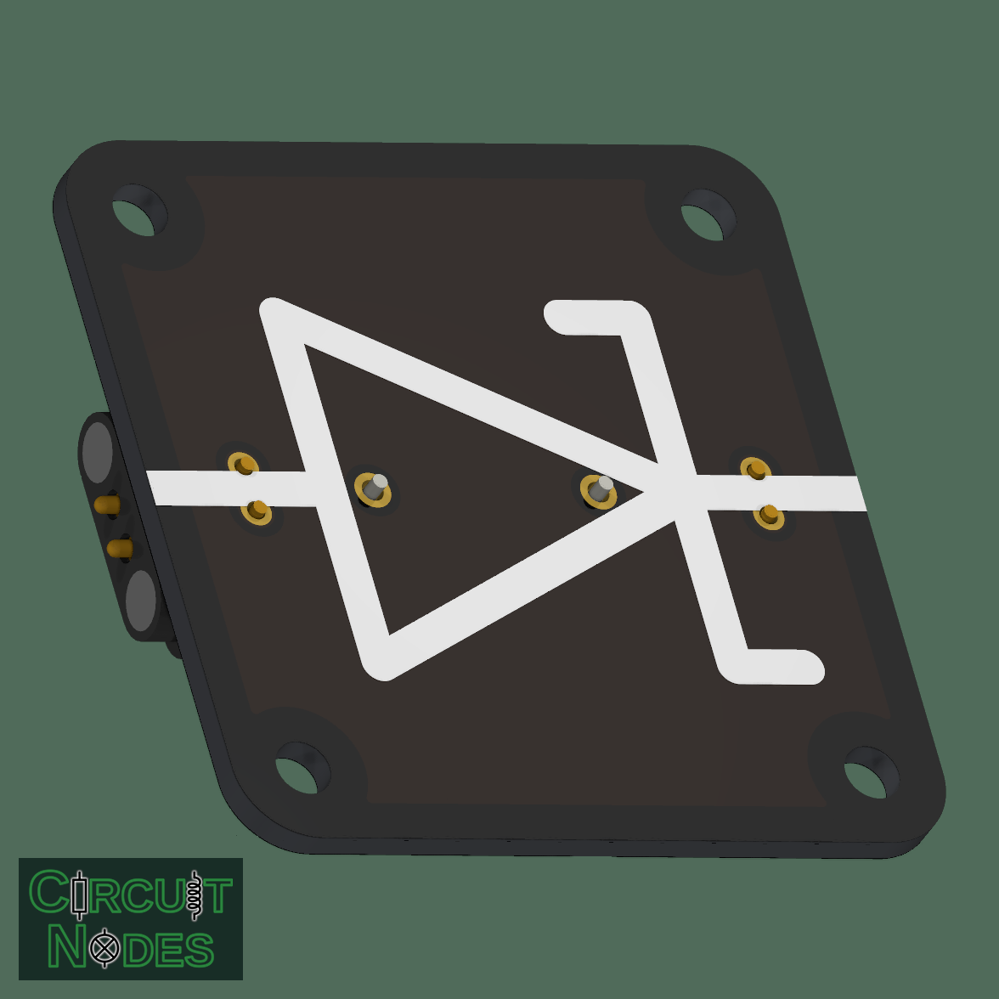
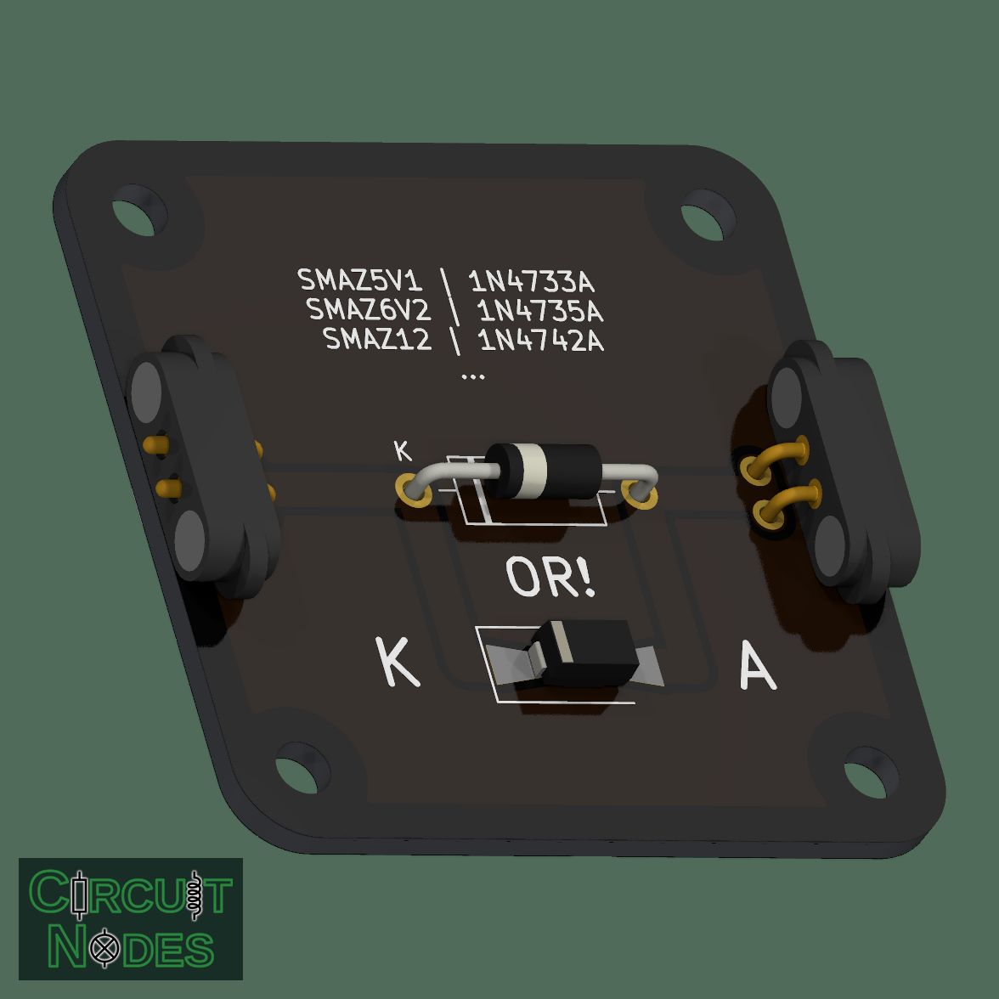

# Zener diode

A Zener diode conducts in reverse once its breakdown voltage is reached. In contrast to other diodes, a Zener diode can endure constant reverse currents without getting destroyed. Thus, this node supports voltage-regulation, reference, and clipping experiments.

 

## Parts and assembly

**Fit either D1 (THT) or D2 (SMT), not both**, as indicated by **OR**. The footprints are connected in parallel; the images show both alternatives.

The schematic uses these **5.1 V example parts** from LCSC; choose the voltage to suit the experiment:

| Reference | Part | Package |
| --- | --- | --- |
| D1 | LGE 1N4733A | DO-41, THT |
| D2 | TECH PUBLIC SMAZ5V1-TP | SMA, SMT |

Bend THT leads to **12.7 mm** spacing. Match the diode's cathode band to the footprint marking and label the fitted voltage on the node or base.

## Choosing the Zener voltage

Select the Zener voltage for the experiment's intended regulation or protection level. For example, clamp the supply feeding an LED and its series resistor to keep the LED current within its rating. The clamp also needs an upstream resistor or current limit.

These alternatives use the same families and packages as the example parts:

| Nominal Zener voltage | SMT: SMAZxx-TP (SMA) | THT: 1N47xxA (DO-41) |
| --- | --- | --- |
| 3.9 V | SMAZ3V9-TP | 1N4730A |
| 4.7 V | SMAZ4V7-TP | 1N4732A |
| 5.1 V | SMAZ5V1-TP | 1N4733A |
| 5.6 V | SMAZ5V6-TP | 1N4734A |
| 6.2 V | SMAZ6V2-TP | 1N4735A |
| 6.8 V | SMAZ6V8-TP | 1N4736A |
| 8.2 V | SMAZ8V2-TP | 1N4738A |
| 10 V | SMAZ10-TP | 1N4740A |
| 12 V | SMAZ12-TP | 1N4742A |
| 15 V | SMAZ15-TP | 1N4744A |

In the SMAZ names, **V marks the decimal point**: `5V1` means 5.1 V, and `6V2` means 6.2 V. Values are nominal at the datasheet's test current; allow for tolerance and current dependence when choosing a protection threshold.

## Teaching and operating notes

- For reverse breakdown, connect the cathode toward positive and the anode toward negative, through an **external series resistor**.
- Vary the supply voltage or load to demonstrate regulation. The measured Zener voltage depends on current, temperature, and tolerance.
- Reverse the diode to demonstrate ordinary forward conduction.

This node has no built-in current limiter. For an unloaded experiment, use `R = (V_supply − V_Z) / I_Z`. With a load, the resistor supplies both diode and load current. Check diode power `P_Z = V_Z × I_Z` and resistor power `P_R = I_R² × R` against the fitted parts' ratings.
