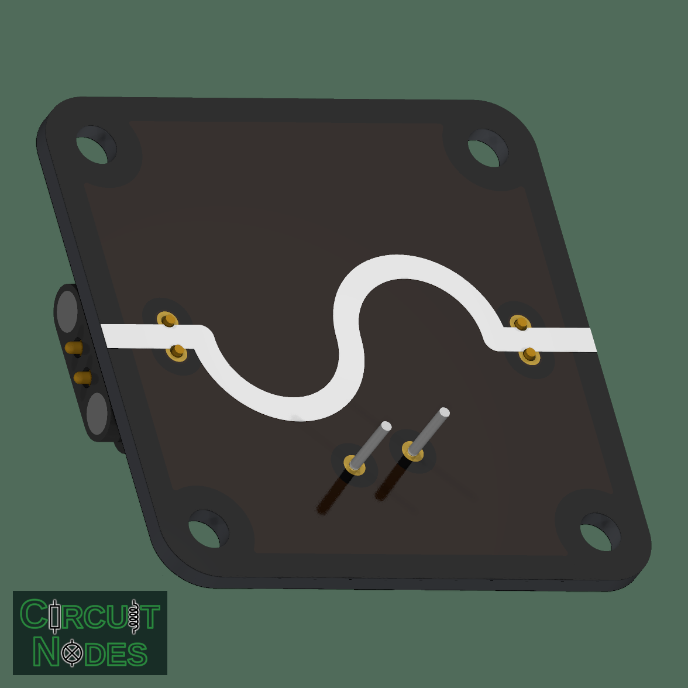
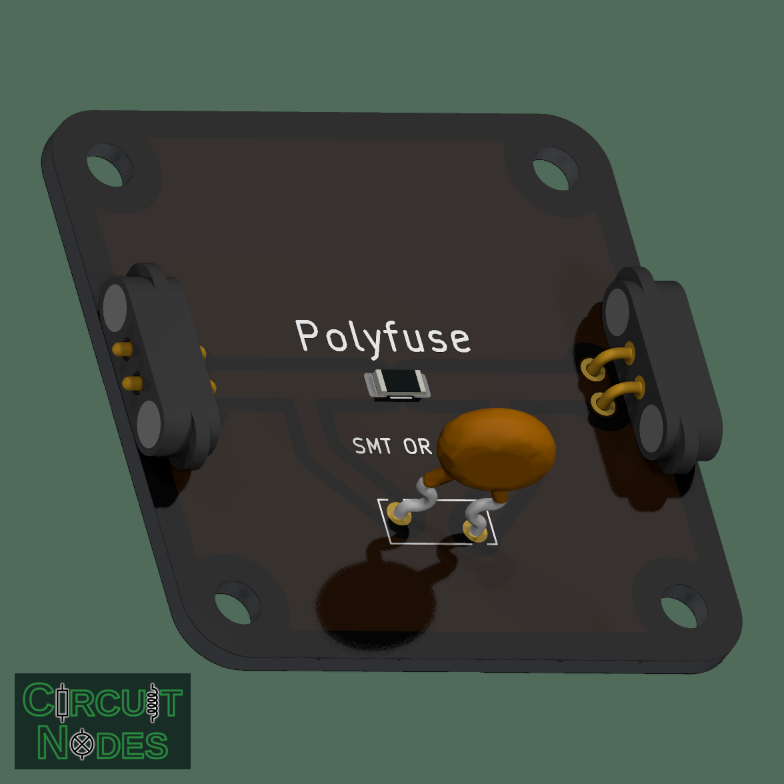

# Polyfuse (resettable fuse, SMT or THT)

A polyfuse is a resettable protection device that increases resistance when heated by an overcurrent and returns to a low-resistance state when cooling. It is useful in classroom kits because it reduces the need to replace components after minor faults.

 

## Typical uses in circuits
- Overcurrent protection in student experiments and small supply modules.

## Didactical notes
- Polyfuses make a good demonstration of thermal feedback and protection behaviours: students can see the circuit limit current and recover after a fault is removed.

## Practical and safety notes
- Choose a polyfuse with an appropriate hold current for your expected loads (for many classroom activities ~100 mA is a reasonable starting point).
- Polyfuses are not instantaneous and may not protect very sensitive components from brief surges; they are a general safeguard rather than a precise protection device.

## Choosing a fuse

Fit **F1 (1206 SMT) or F2 (radial THT), never both**. The footprints are connected in parallel; fitting both changes the protection behaviour. Neither fuse is polarized. The THT footprint uses 5.1 mm lead spacing with staggered holes; gently form the leads if needed and solder after any SMT reflow.

These Littelfuse parts are listed at LCSC and fit the respective footprints:

| Part | LCSC | Mounting | Hold current | Trip current | Maximum voltage |
| --- | --- | --- | --- | --- | --- |
| 1206L010/30WR | C2153988 | F1, 1206 SMT | 100 mA | 250 mA | 30 V |
| 1206L012WR | C151160 | F1, 1206 SMT | 125 mA | 290 mA | 30 V |
| 1206L025/24YR | C3762322 | F1, 1206 SMT | 250 mA | 550 mA | 24 V |
| RXEF010 | C5392 | F2, radial THT | 100 mA | 200 mA | 60 V |
| RXEF020 | C413561 | F2, radial THT | 200 mA | 400 mA | 72 V |

The KiCad defaults are the two 100 mA options. Hold current is the current the fuse can carry without tripping; trip current is higher. These ratings apply at 20 °C and decrease as temperature rises. Select for the experiment's normal current and supply voltage. After a fault, disconnect power and let the fuse cool before restarting.
