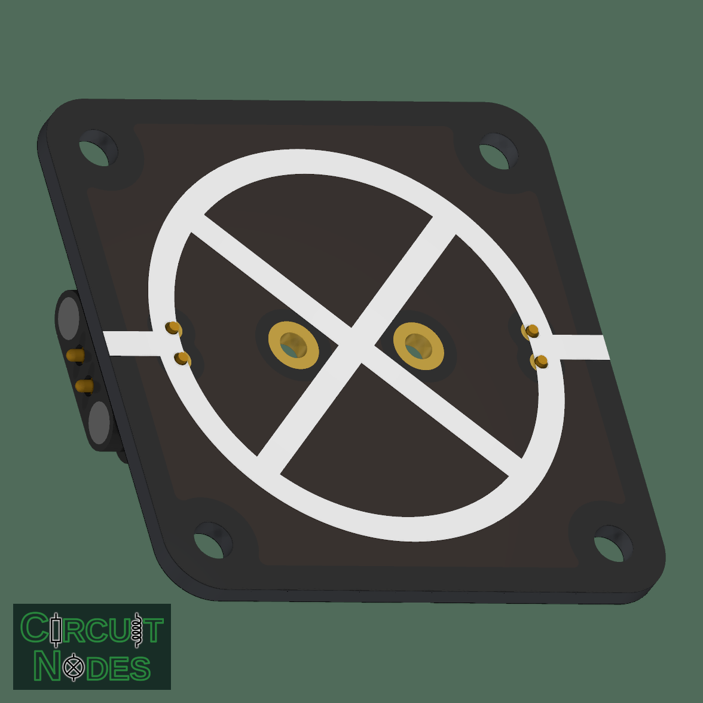
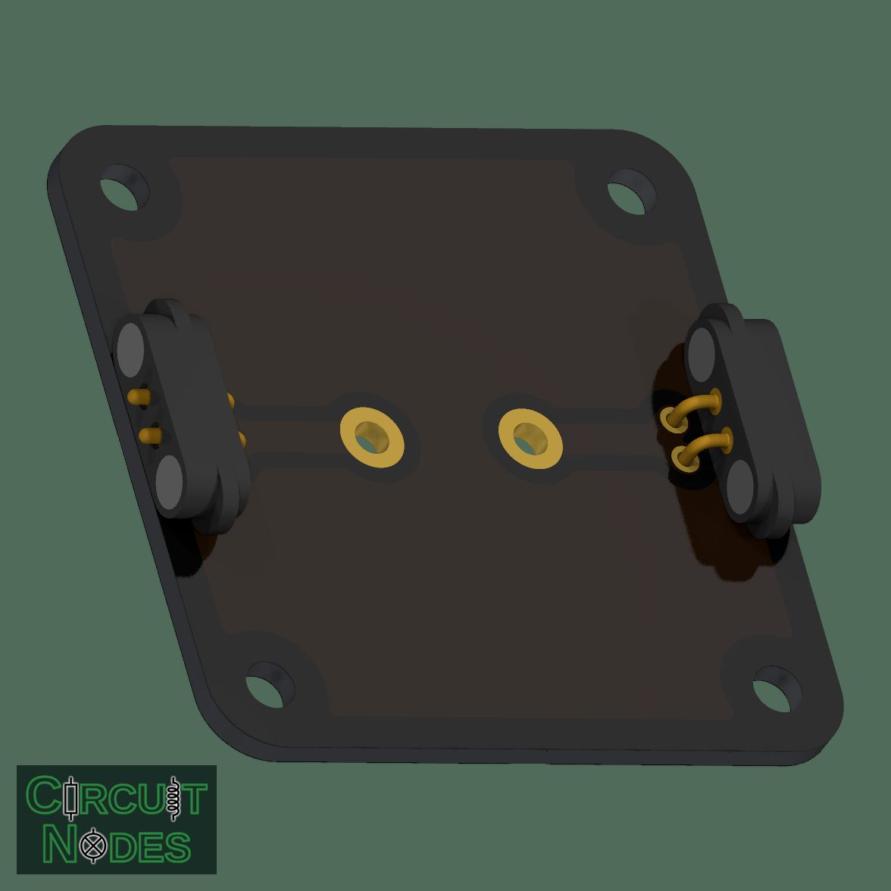
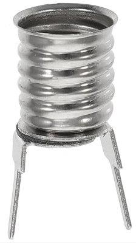

# Lamp (E10, THT)

A small E10 incandescent lamp makes current flow visible. Its filament resistance increases as it heats, so startup current is higher than steady-state current.

  

## Socket mounting

The PCB uses **two solder holes**, not a standardized E10 socket footprint: 10 mm centre spacing, 2.1 mm hole diameter. Check your socket's solder tabs before fitting it. Form the tabs or use short wires if necessary, and secure the holder so changing a bulb does not strain the solder joints.

## Classroom use

Use it for simple series circuits, voltage/current measurements, and comparing a lamp's changing resistance with a resistor.

## Practical and safety notes
- Match the bulb's voltage rating to the supply; the PCB does not limit current.
- Incandescent lamps are not polarized and can become hot. Let the bulb cool before handling it.
- E10 LED replacements behave differently; follow their voltage and polarity requirements.

