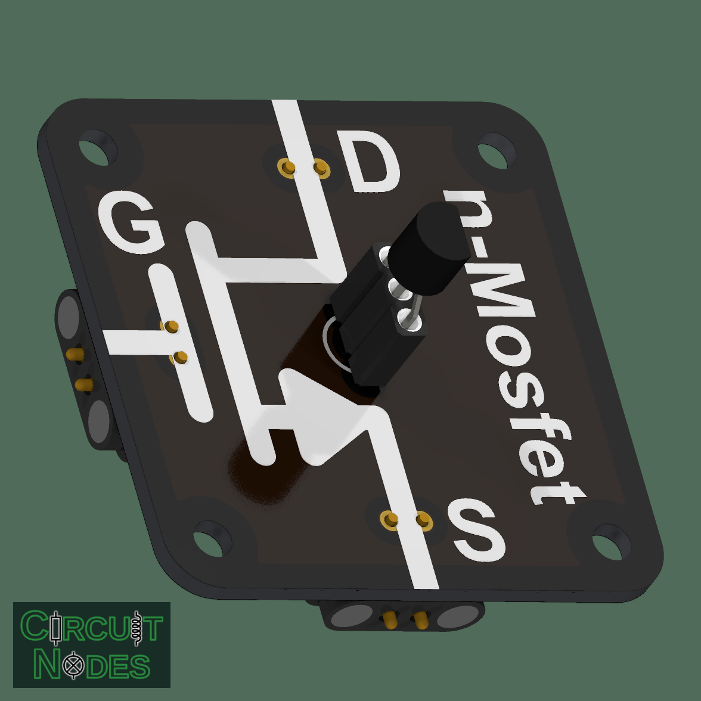
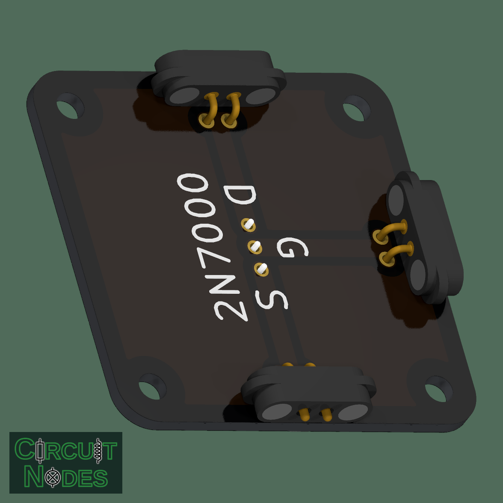

# Replaceable N-channel MOSFET (TO-92)

This node demonstrates how a gate voltage controls current through a transistor.

**The MOSFET is unprotected, but replaceable using the precision socket.** There is no built-in protection against incorrect connections, excessive gate voltage, or excessive current. The socket makes it easy to replace a damaged MOSFET or compare different types; it does not provide electrical protection.

 

## Connections and classroom use

| Terminal | Function |
| --- | --- |
| G: gate | Controls conduction through its voltage relative to the source |
| D: drain | Connects to the load; the other side of the load connects to the positive supply |
| S: source | Connects to the supply return in a low-side switching experiment |

At approximately zero gate-to-source voltage, the transistor is off in the normal drain-to-source direction. Increasing gate voltage allows current to flow. **Threshold voltage marks the beginning of conduction, not full turn-on.** These parts are useful for small-load experiments around a 5 V gate drive; do not assume reliable full turn-on at 3.3 V.

- Measure load current as gate voltage changes.
- Compare voltage-driven gate control with the base current of an NPN transistor.
- Observe that a disconnected gate can retain charge. An external gate-to-source pull-down resistor, for example 100 kΩ, gives a defined off state.
- Investigate the internal body diode: an off MOSFET does not block current equally in both directions.

## Suggested parts and usage

The three contacts have 2.54 mm spacing. Solder a precision socket onto the diagram side and plug the MOSFET into it, as shown above. This allows a damaged MOSFET to be replaced or different types to be compared. A matching MOSFET can also be soldered directly into the same pads.

Use a TO-92 MOSFET with **1 = source, 2 = gate, 3 = drain (S-G-D)**. Wide in-line leads fit the socket pitch; closely spaced leads can be gently spread beforehand.

| MOSFET | Maximum drain-source voltage | Pin order, flat face toward you and leads pointing down |
| --- | --- | --- |
| 2N7000 | 60 V | S-G-D |
| TN0606N3-G | 60 V | S-G-D |
| VN0106N3-G | 60 V | S-G-D |
| TN0610N3-G | 100 V | S-G-D |
| VN10KN3-G | 60 V | S-G-D |

These are pin-compatible options, but their switching characteristics and current limits differ. Check the exact manufacturer's datasheet before fitting a replacement. The drain-source rating is not the permissible gate voltage.

**Insert the MOSFET with each lead connected to the corresponding S, G, or D terminal.** Disconnect power before replacing it.

## Practical notes

This node has no built-in gate protection, pull-down resistor, load-current limiter, or flyback diode. Use an external resistor/current limit for the load and a flyback diode for inductive loads.

