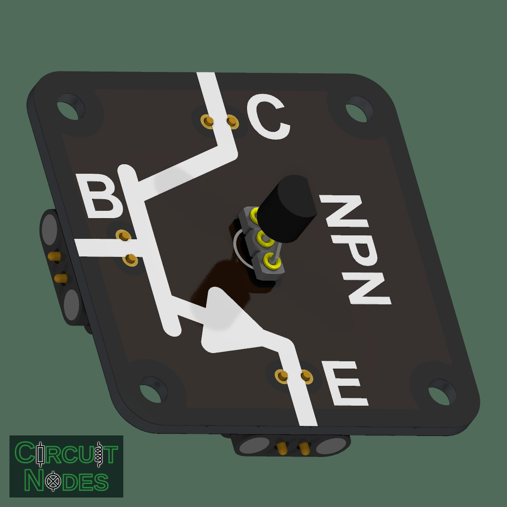
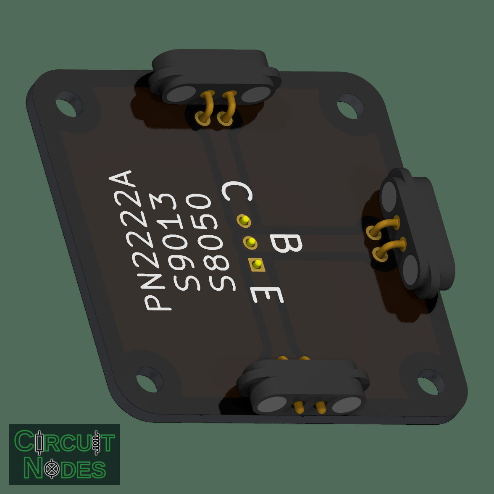

# Replaceable NPN bipolar junction transistor (TO-92)

This node demonstrates how a small base current controls a larger collector current. Use it for low-side switching of an LED or another small load, introductory amplification experiments, and comparison with a MOSFET.

**The transistor is unprotected, but replaceable using the precision socket.** The socket allows a damaged transistor to be replaced or different types to be compared. It provides no electrical protection.

 

## Connections and classroom use

| Terminal | Function |
| --- | --- |
| B: base | Receives the control current through an external resistor |
| C: collector | Connects to the load; the other side of the load connects to the positive supply |
| E: emitter | Connects to the supply return in a low-side switching experiment |

With no base current, collector current is normally very small. Supplying base current allows a larger collector current to flow. The base-emitter junction behaves like a diode: around 0.6-0.8 V is typical during conduction, depending on current and temperature.

- Measure collector current as base current changes.
- Observe saturation: increasing base current eventually produces little further reduction in collector-emitter voltage.
- Compare base current with the gate-voltage control of a MOSFET.

## Suggested parts and replacement

The three socket contacts have 2.54 mm spacing. The precision socket and transistor sit on the side with the large schematic symbol. Wide in-line TO-92 leads fit the pitch; closely spaced leads can be gently spread beforehand. A matching transistor can also be soldered directly into the pads.

**The socket uses 1 = emitter, 2 = base, 3 = collector.** With the transistor's flat face toward you and its leads pointing down, use an **E-B-C** part.

| Part | Manufacturer checked | Pin order |
| --- | --- | --- |
| PN2222A | onsemi / Fairchild | E-B-C |
| S8050 | JSCJ | E-B-C |
| S9013-G | MCC | E-B-C |

These are pin-compatible options, but ratings and current gain differ. Check the exact manufacturer's datasheet before fitting a replacement. Similar names such as 2N2222 and P2N2222A do not guarantee the same package or pin order.

Disconnect power before replacing the transistor and connect each lead to the corresponding E, B, or C terminal.

## Practical notes

There is no built-in base resistor, load-current limiter, or flyback diode. Always limit base current with an external resistor. Use a series resistor for an LED, a suitable current limit for the load, and an external flyback diode across an inductive load. Start with small load currents and stay within the chosen transistor's ratings.
